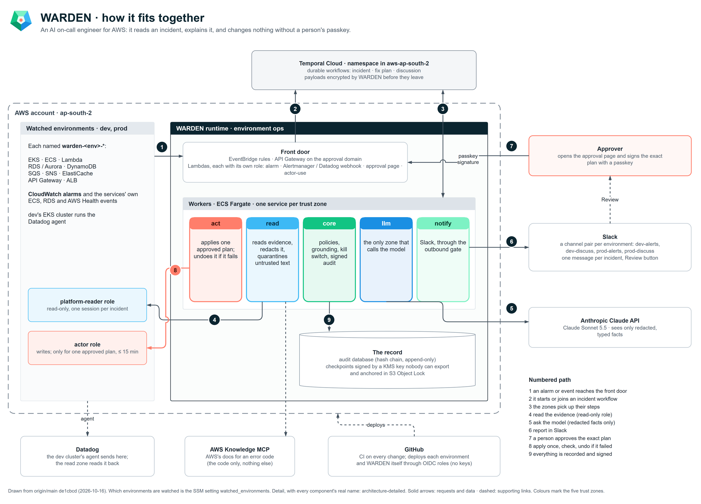
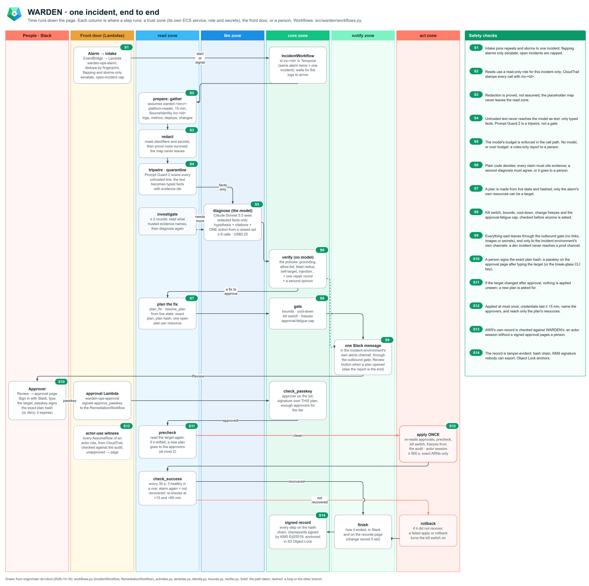
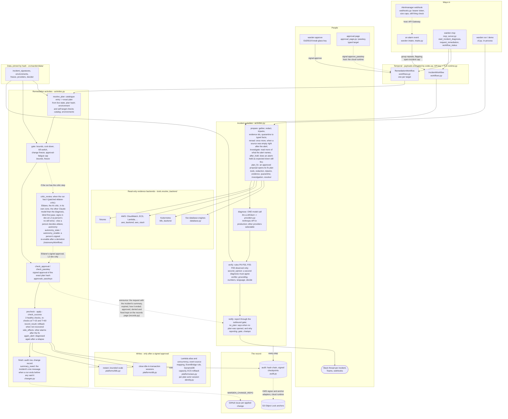
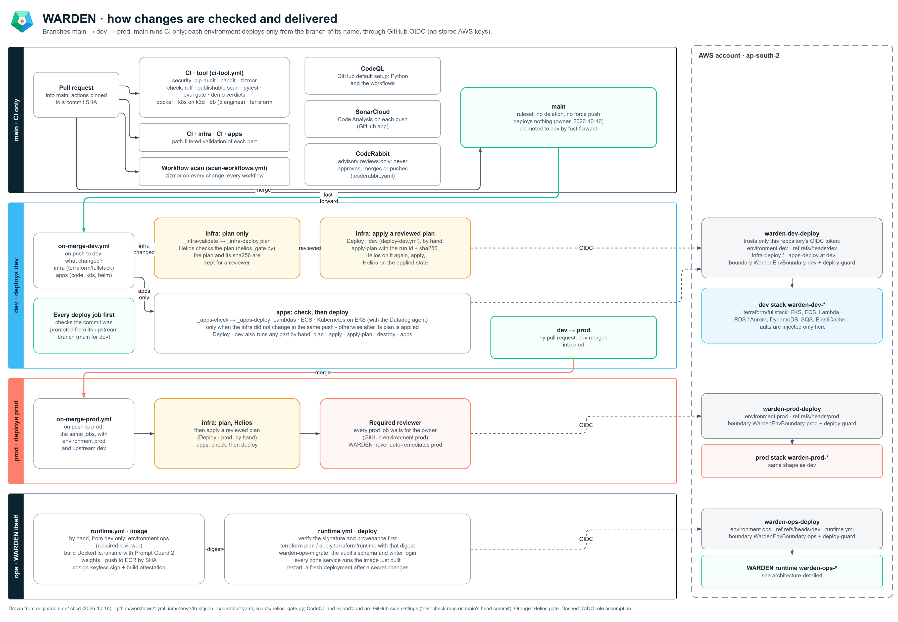
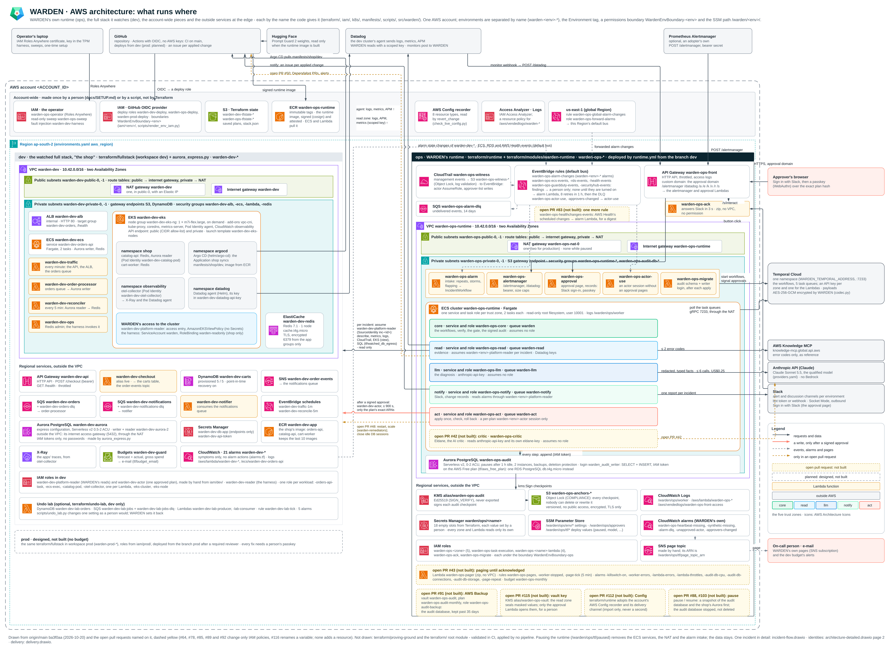

# WARDEN

[](https://github.com/veerarakesh56/warden/actions/workflows/ci-tool.yml)
[](https://www.python.org)
[](LICENSE)

WARDEN is an AI on-call engineer for AWS. When an alarm fires, it gathers the evidence, finds the likely cause, writes
a short report in Slack and proposes a fix. Nothing changes until that exact fix is approved: in production always
by a person, with a passkey; in the `dev` environment by Eldane, a second AI that reviews the fix, unless a person
says no first. Then WARDEN applies it, checks that it worked and undoes it if it did not, and every step is recorded.

## How it works

1. **An alarm fires.** A CloudWatch alarm (or a Kubernetes alert) reaches WARDEN, and WARDEN opens an incident.
2. **It collects the facts first.** It reads the logs, metrics, recent deploys and recent changes, with read-only
   access, before the AI sees anything. Passwords, keys and personal details are blanked out.
3. **The AI names a likely cause and one fix.** The fix must come from a short, fixed list (restart, scale up, roll
   back a deploy, close stuck database sessions and a few more), and each claim must point at the evidence.
4. **Ordinary code checks the answer.** Fixed rules, not the AI, decide whether the fix may be offered, is too risky,
   or should go to a person with no fix at all.
5. **It reports in Slack:** what broke, the likely cause, the proposed fix and who should act.
6. **The exact fix is approved.** In production that is always a person, with a passkey on WARDEN's approval page
   (or a signing key on the command line). In `dev`, Eldane - a second Claude model that reviews the fix and is
   always labelled an AI - approves it alone when it agrees; the channel is told, and a person can deny it with their
   passkey for five minutes, and until the apply step starts. People can still discuss the incident in Slack and
   ask for a new plan. If anything the fix depends on changes first, WARDEN makes the plan again and asks again.
7. **It applies the fix once, checks that the service recovered, and undoes the fix if it did not.**

[](docs/diagrams/architecture-overview.svg)

*The whole system on one page: an alarm comes in, WARDEN's separate parts read the evidence, ask the AI, check its
answer and report, and nothing changes until the exact fix is approved. Click a picture for a sharp copy.*

[](docs/diagrams/incident-flow.svg)

*One incident from the alarm to the signed record, step by step, with every safety check marked.*

## What keeps it safe

- **Nothing is applied without a signed approval of that exact fix.** The AI that diagnoses only suggests. In
  production the approval is always a person's. In `dev` it may be Eldane's, the AI critic's: its own zone, its own
  signing key, small reversible fixes only (tiers T1 and T2), never a change to WARDEN itself, never while the kill
  switch is on - and a person's "no" overrides it. A failed fix, a rollback, a person's veto, a change of either
  model or a missed catch trial (a planted bad plan Eldane said yes to) puts `dev` back to "a person approves" until
  a person signs it back on (`warden autonomy enable`, [OPERATIONS.md](docs/OPERATIONS.md)).
- **A kill switch.** `warden killswitch on` stops every fix at once. Turning it off again needs a signed approval.
- **Reading and writing are kept apart.** The parts that gather evidence can only read. Writing uses a separate
  identity with tight limits: on AWS, a short-lived session for one approved fix; on Kubernetes, a deployment can be
  scaled up by at most two replicas.
- **Text from the systems it reads is treated as data, never as orders.** A log line or an alert can hide
  instructions planted by an attacker. WARDEN turns such text into numbered facts that the AI can quote but cannot
  take orders from; the code calls this *quarantine*. An optional local detector flags text that looks like an attack.
- **Secrets are masked** before any text leaves WARDEN, and checked again on the way out.
- **Every step is recorded** in a tamper-evident audit log. In the cloud runtime the log is signed with a key held by
  AWS KMS and anchored in write-once S3 storage.
- **Spending limits.** The AI's cost has a ceiling per incident and per day.

## What it is not, and its limits

**What this is, and is not.** WARDEN is an engineering project that builds an AI incident responder with a person in
control, end to end, and measures it honestly. Its ideas are not new: evidence first, fixed rules, human approval and
least privilege are where the field is going (AWS DevOps Agent, HolmesGPT, Meta's DrP and incident.io's AI SRE work
the same way). It is not offered as a product to adopt as-is. Read [the benchmarks](docs/BENCHMARKS.md) and
[the failure-mode register](docs/FAILURE-MODES.md) before trusting any part of it.

- **No published run has applied a fix on a live AWS account.** WARDEN has read a real AWS account, and its fixes
  are tested in CI against a real Kubernetes cluster (k3d) and real database servers.
- **It can be wrong.** The AI does not always give the same answer to the same evidence, and a confident,
  well-supported wrong answer can still reach the approver. That is why every production fix waits for a person.
- **In `dev`, an AI approves another AI's fix.** Eldane is the other Claude model (Opus 5.5 or Sonnet 5.5) from the
  one that diagnosed, on the same API key. Models of one family share blind spots and tend to prefer answers like
  their own; what is done about it - a blind first pass, citations checked in code, catch trials, demotion at the
  first failure, a person's veto - is in [`eldane.py`](src/warden/eldane.py). It has not yet approved a fix on a live
  account.
- **It fixes only what is on its list.** Anything else, including database failover, schema changes and anything
  that deletes, is handed to a person.
- **It sees only what its access allows,** and masking works from known patterns: a secret in a format no pattern
  knows is not caught.
- **One person approves.** This deployment's approver list has one person, whose approval decides alone; the code
  supports requiring two. `dev`, where the test bench runs, also has a second, labelled approver: a test key that Claude
  (the AI that helps build WARDEN) holds, `scripts/bench_approve.py`. It may approve only small, reversible fixes,
  only in `dev` (tiers T1 and T2, set by the owner on 2026-10-15), and every approval it gives is recorded as
  `bench`. WARDEN refuses the bench approver in any environment that is not of the nonprod tier, whatever its
  entry in the approver list says, and makes its key only for a nonprod environment.
- **The measurements are limited:** synthetic held-out incidents, single runs, and live reads from September 2026
  under an older version. Details are in [Status and limits](#status-and-limits).

## Quick start

No cloud account and no API key: mock mode runs the whole pipeline deterministically on five recorded incidents.

```bash
docker compose up                 # mock mode by default
```

or

```bash
pip install -e ".[dev]"
WARDEN_MOCK=1 warden demo --verbose
WARDEN_MOCK=1 warden run --incident inc-004 --report      # one incident, with its redacted report
```

| Incident | Evidence | Proposal | Verdict |
|---|---|---|---|
| `inc-001` | 5xx spike after a deploy | `rollback_deploy` | approved for a person |
| `inc-002` | OOM kills, no deploy | `scale_up` | approved for a person |
| `inc-003` | replica lag | `failover_replica` | **rejected**: failover is irreversible and multi-service in prod |
| `inc-004` | two vague log lines | `escalate_to_human` | auto-safe: it declines to invent a fix |
| `inc-005` | pool full of idle-in-transaction sessions | `terminate_connections` | approved for a person |

`warden run` changes nothing: a live change goes only through the `RemediationWorkflow`.

### Run the workflows locally

With the [Temporal CLI](https://docs.temporal.io/cli) installed:

```bash
temporal server start-dev                                          # a local Temporal server
export WARDEN_TEMPORAL_KEY=$(python -c "import os,base64;print(base64.b64encode(os.urandom(32)).decode())")
WARDEN_MOCK=1 warden worker &                                      # --platform none: every live change is refused
printf '%s' '{"rule": "PodOOMKilled", "state": "ALARM", "transitioned_at": "2026-08-21T14:11:00Z", "alert": {"alert_id": "inc-002", "name": "PodOOMKilled", "severity": "high", "service": "checkout", "environment": "prod", "summary": "Repeated OOM kills", "started_at": "2026-08-21T14:11:00Z"}}' > event.json
WARDEN_MOCK=1 warden intake event.json                             # an alarm event: started, grouped or escalated
```

To let a worker change something, connect a platform (`warden worker --platform k8s|db|aws|all`) and approve a plan
with `warden status <workflow-id>` and `warden approve <workflow-id> --plan-hash <hash> --approver <id> --key ~/.warden/<id>.pem`
(key files are read only from the key folder, `WARDEN_KEY_DIR`, default `~/.warden`).

### Deploy it

[docs/SETUP.md](docs/SETUP.md) walks through the AWS roles, the GitHub environments, secrets and variables, Temporal
Cloud and Slack. The runtime is a Terraform module, [`terraform/modules/warden-runtime`](terraform/modules/warden-runtime);
day-two operations (key rotation, the kill switch) are in [docs/OPERATIONS.md](docs/OPERATIONS.md), and what to do
when WARDEN itself misbehaves is in [docs/RUNBOOK-WARDEN-INCIDENT.md](docs/RUNBOOK-WARDEN-INCIDENT.md).

## Documentation

| Document | What it covers |
|---|---|
| [ARCHITECTURE.md](docs/ARCHITECTURE.md) | Workflows, trust zones, the approval page, the gate and quarantine |
| [diagrams/](docs/diagrams/README.md) | The overview, detailed, incident-flow, delivery and AWS architecture diagrams, and their editable sources |
| [ai-boundary.md](docs/ai-boundary.md) | Why the model never decides, and the policy table |
| [SETUP.md](docs/SETUP.md) | Setting WARDEN up in your own AWS and GitHub accounts |
| [AWS-SETUP.md](docs/AWS-SETUP.md) | The AWS identities the benchmark stack uses |
| [PRODUCTION-ARCHITECTURE.md](docs/PRODUCTION-ARCHITECTURE.md), [SYSTEM-COMPONENTS.md](docs/SYSTEM-COMPONENTS.md) | The cloud runtime, its components and their cost |
| [OPERATIONS.md](docs/OPERATIONS.md), [RUNBOOK-WARDEN-INCIDENT.md](docs/RUNBOOK-WARDEN-INCIDENT.md) | Running it, and what to do when WARDEN itself is the incident |
| [BENCHMARKS.md](docs/BENCHMARKS.md), [scenarios/SCORING.md](scenarios/SCORING.md) | Every measured result, and how it is graded |
| [FULLSTACK-LAB.md](docs/FULLSTACK-LAB.md) | The full-stack test environment and its injected faults |
| [FAILURE-MODES.md](docs/FAILURE-MODES.md) | What can go wrong with an automated WARDEN, and what holds each |
| [DESIGN-DECISIONS.md](docs/DESIGN-DECISIONS.md), [ENGINEERING-NOTES.md](docs/ENGINEERING-NOTES.md) | Why each choice was made; defects found while building it |
| [COMPLIANCE-CROSSWALK.md](docs/COMPLIANCE-CROSSWALK.md), [governance/](docs/governance/) | NIST AI RMF, ISO/IEC 42001, OWASP and EU AI Act mapping; policy documents |
| [ROADMAP.md](docs/ROADMAP.md), [CHANGELOG.md](CHANGELOG.md) | What is next, and what changed |

## How it is built

### Why

Ask a language model to fix an incident and it will always produce something. Given thin evidence it does not say
"I don't know"; it produces a confident, plausible action. In a chat assistant that is a bug. In an operations tool it
is an outage with a good explanation attached.

An agent that can act on production needs what operations software has always needed: evidence, proportionality, an
audit trail, a cost ceiling and a person in the loop. WARDEN is an attempt to build those around one model call and
to measure where they hold and where they do not.

### The pipeline

```
alert -> gather evidence -> redact -> quarantine -> diagnose (one model call) -> verify -> escalate | plan a fix
                                                                                              |
                                        signed approval of the exact plan -> apply once -> check -> keep or roll back
```

1. **Evidence first.** Read-only backends gather logs, metrics, deploys and recent changes *before* the model runs,
   each under a hard timeout. The model does not choose what to look at.
2. **Redaction and quarantine.** Secrets and identifiers are masked before anything leaves the process, and raw log
   text is turned into numbered, typed facts. The model sees evidence as data, never as instructions.
3. **One model call.** The model returns a hypothesis with citations and one action from a **closed list**. It cannot
   invent `delete_database`.
4. **A deterministic verifier.** Plain Python rules (P0-P33) decide: reject, escalate to a person, or allow the
   proposal to go to an approver. Each verdict lists every rule that fired. New rules run in observe mode first
   (P25-P28 today): recorded on every verdict, obeyed by none, until they are measured.
5. **A fix is a plan, not a command.** An allowed proposal opens a plan from a fixed catalogue, made from what WARDEN
   reads live. An approver approves the plan's hash: in production a person; in `dev` Eldane, the AI critic, unless a
   person denies it first. WARDEN applies it once, checks that the service recovered, and rolls back if it did not.

Everything runs as [Temporal](https://temporal.io) workflows: `IncidentWorkflow` for a diagnosis and one
`RemediationWorkflow` per target. The full design is in [docs/ARCHITECTURE.md](docs/ARCHITECTURE.md), and why the
model never decides is argued in [docs/ai-boundary.md](docs/ai-boundary.md).

### The whole system on one page

Every box is a module or file in this repository, and every arrow is a call that exists in the code. Dotted arrows
are optional (a flag, a setting, or a part hosted by the cloud runtime). `tests/test_readme_architecture_r30.py`
checks that every module and activity named here exists.



### How a change to WARDEN is delivered

[](docs/diagrams/delivery.svg)

*How a change reaches an environment: `main` runs the tests and deploys nothing; the `dev` and `prod` branches each
deploy their own environment, without stored AWS keys, and infrastructure changes only from a reviewed plan.*

### What runs where in AWS

[](docs/diagrams/aws-architecture.svg)

*WARDEN's own runtime (`ops`), the full stack it watches (`dev`), the account-wide pieces and the outside services,
each by the name the code gives it. Dashed yellow: an open pull request, not built. `prod` is designed, not built.*

Every component by its real name is in the detailed diagrams:
[the runtime](docs/diagrams/architecture-detailed-1.svg) and
[identities, environments and outside services](docs/diagrams/architecture-detailed-2.svg). Their editable sources
and how to re-export them are in [docs/diagrams/](docs/diagrams/README.md).

## Safety model

Each control below is enforced in code and covered by tests; the limits are stated next to it.

| Control | What it does | Limit |
|---|---|---|
| **Read-only evidence** | Every evidence backend is read-only by construction; tests walk each module's syntax tree for write-shaped calls. Its identity is scoped to reads (IAM actions, Kubernetes RBAC, a database login). | A reader sees only what its identity can see; each report says what was and was not read. |
| **Redaction** | Emails, IPs, UUIDs, private keys, connection-string passwords, JWTs, cloud and SaaS credentials, card numbers and IBANs are masked before any text leaves the process. The outbound gate re-runs every pattern on what leaves and withholds a secret. | Pattern-based: a secret no pattern knows is not caught. |
| **Quarantine** | Untrusted text becomes numbered, typed facts; the model's citations must point at them. An optional local detector (Meta's Llama Prompt Guard 2, `WARDEN_TRIPWIRE`) escalates text that looks like an injection. | The detector misses some attack shapes; it is a tripwire, not the defence. |
| **Closed action list** | The model must return one action from a fixed enum, or the call fails. | The list is coarse; a person still judges the target. |
| **Deterministic verifier** | Rules over typed data decide the verdict; confidence can stop an action but never start one. | Rules catch what they were written for; a confident, well-evidenced wrong answer can still reach an approver. |
| **Trust zones** | In the cloud runtime, each zone (core, read, llm, notify, act, critic) is its own Fargate service with its own task role and secrets. The model zone holds the model's key; it cannot assume the reader or actor roles. Each front-door Lambda has its own role, reading only the secrets its handler reads. | One AWS account per deployment; the zones share it. |
| **Signed approvals** | A fix applies only with an Ed25519 signature (`warden approve`) or a passkey on the approval page over the exact plan hash. The hash covers the environment, the catalogue, WARDEN's own code and the incident's audit record; if any changes, the plan is made again and put to the approver again. | This deployment has one person on the approver list. The code supports a two-person rule (`required: 2`); one approver's key decides alone where it is 1, and every record says so (`single_approver`). In `dev` only, the labelled bench approver (`bench`, a test key Claude holds) may also approve T1 and T2 plans; WARDEN refuses it in any environment not of the nonprod tier, whatever its entry says (`approvals.environment_refusal`). Eldane, the AI critic, is an approver marked `ai`: dev only, T1 and T2, never a passkey, always shown as "Eldane · AI critic", and its approval is checked again right before apply (`autonomy.ai_problems`). |
| **Bounded writes** | Each platform re-checks its own bounds: Kubernetes restarts or scales up by at most two; databases close only sessions idle in a transaction, for the application's own logins; AWS writes use a short-lived actor session for one plan. | See [Status and limits](#status-and-limits) for what has run where. |
| **Kill switch and freezes** | `warden killswitch on` stops every remediation; a reset needs a signed approval. Change freezes, cool-downs and an approval-fatigue cap are checked before every apply. | |
| **Budget** | Per-incident USD and call ceilings (`WARDEN_MAX_USD`, `WARDEN_MAX_CALLS`) and a daily cap (`WARDEN_DAILY_MAX_USD`). With no model, or over the cap, an incident is escalated on the rules alone. | Prices come from `providers.yaml`; a provider that reports no usage is made to over-estimate. |
| **Audit** | Every step is recorded in a hash chain with signed checkpoints; the cloud runtime signs with KMS and anchors to S3 Object Lock. | |

Environments are data: [`src/warden/data/environments.yaml`](src/warden/data/environments.yaml) sets each
environment's allowed actions and principals. An environment it does not list falls to a default that can only
escalate.

| Environment | Fixes it may offer | Fixes it never offers |
|---|---|---|
| `dev` (run as production) | the reversible ones prod allows: restart, scale up, roll back a deploy, close idle sessions, revert a config or change, pause or resume a flow, shift traffic, raise a limit, freeze changes | scale down, failover, redrive messages, cancel a query (the irreversible ones) |
| `prod` | the same, plus failover, clear a cache, redrive messages, cancel a query (rule P2 then refuses the irreversible ones) | scale down |
| any other name | none: it can only escalate to a person | everything (**fails closed**) |

Every fix waits for a signed approval of its exact plan. In `prod` that is always a person's. In `dev` it may be
Eldane's, alone (`autonomy: L2` in `environments.yaml`), or the labelled bench approver's, for T1 and T2; a person's
"no" stops either until the apply step starts. Prod's ceiling is L1 - Eldane reviews and is scored, a person approves - and an L2
for a prod-tier environment is refused when the file is loaded.

## Configuration

Everything is set by environment variables. In the cloud runtime, plain values come from SSM Parameter Store and
secrets from AWS Secrets Manager (`src/warden/settings.py`); each trust zone may read only its own secrets.

| Variable | Meaning |
|---|---|
| `WARDEN_MOCK=1` | Deterministic, no network, no model. What CI runs. |
| `WARDEN_PROVIDER`, `WARDEN_MODEL` | The model provider and model id. The default provider is `anthropic`, whose default model is `claude-sonnet-5-5`. |
| `ANTHROPIC_API_KEY` | The Anthropic API key. In the cloud runtime, only the llm zone reads it, from Secrets Manager. |
| `WARDEN_MODEL_EFFORT` | Override the reasoning effort set per model in `providers.yaml`. |
| `WARDEN_BACKEND` | Evidence source: fixtures (default), `aws`, `k8s`, `postgres`, `mysql`, `redis`, `mongo`, `mssql` or `db`. |
| `WARDEN_ENV`, `WARDEN_ENV_POLICY_PATH` | The environment WARDEN runs in, and an alternative environment-policy file. |
| `WARDEN_MAX_USD`, `WARDEN_MAX_CALLS`, `WARDEN_DAILY_MAX_USD` | Cost and call ceilings. |
| `WARDEN_TEMPORAL_ADDRESS`, `WARDEN_TEMPORAL_NAMESPACE`, `WARDEN_TEMPORAL_API_KEY`, `WARDEN_TEMPORAL_KEY` | The Temporal server, its namespace, the zone's API key, and the payload encryption key (32 random bytes, base64). |
| `WARDEN_TRIPWIRE` | `on` or `required` to run the injection detector (`pip install -e ".[guard]"`). |
| `WARDEN_TRACE_CONSOLE`, `OTEL_EXPORTER_OTLP_ENDPOINT` | OpenTelemetry spans to the console, or over OTLP (GenAI semantic conventions). |
| `WARDEN_SLACK_BOT_TOKEN`, `WARDEN_SLACK_WEBHOOK` | Where reports go. |

**Models.** WARDEN is not tied to one vendor: `providers.py` supports the Anthropic API, Amazon Bedrock, Gemini,
OpenAI-compatible hosts (OpenAI, Groq, OpenRouter, Ollama for fully local use) and the `claude` command-line tool.
But a model diagnoses only after it passes WARDEN's replay set: `scripts/qualify_provider.py` re-diagnoses 30
incidents recorded on a live AWS account, and only a model with no wrong answer let through and at least 17 correct
is listed in [`src/warden/data/providers.yaml`](src/warden/data/providers.yaml). Any other pair is refused. Today the
one qualified model is **Claude Sonnet 5.5** (`claude-sonnet-5-5`) on the Anthropic API. Qualify another before you
use it.

Keys and connection strings are read from the environment. Put them in a gitignored `.env` file or export them from
a secret manager; never type one on the command line, where it stays in the shell's history.

Examples of each evidence source:

```bash
pip install -e ".[aws]"; WARDEN_BACKEND=aws WARDEN_AWS_CLUSTER=<cluster> warden run --incident inc-002 --service <service> --started-at now
pip install -e ".[k8s]"; WARDEN_BACKEND=k8s warden run --incident inc-002       # the cluster your kubeconfig points at
pip install -e ".[postgres]"; WARDEN_BACKEND=postgres warden run --incident inc-005   # WARDEN_DB_DSN exported
```

For Kubernetes, `kubectl apply -k k8s/` installs a read-only ServiceAccount (get and list only, bound per namespace)
and `k8s/job.yaml` runs one diagnosis as a Job under the `restricted` Pod Security standard. The separate write
identity is [`k8s/remediation-rbac.yaml`](k8s/remediation-rbac.yaml): get and patch deployments, held by an admission
policy to the replica count and the restart annotation. In the cloud runtime the read and act zones connect Kubernetes
and the database too (`--platform aws,k8s,db`): reads in each watched environment's platform-reader role (view-only on
EKS; the database's pg_monitor login), every write in the approved plan's own actor session (on EKS the remediator
group, bound in `shop` only; on the database the `warden_<env>_terminate` login, an IAM token and no password, its
server's certificate verified, on the cluster the approved plan was read from). An
environment with no EKS cluster (`WARDEN_EKS_CLUSTERS`) or database (`WARDEN_DB_ENVIRONMENT`) configured reads and
changes nothing there; its plans go to a person.

### MCP server

`pip install -e ".[mcp]"` and `warden-mcp` expose the policy gate to any MCP client. Most MCP servers give an agent
more capability; this one gives it a constraint. `verify_remediation` returns a binding verdict with the policy ids
that fired, and every response carries `may_execute: false`. `WARDEN_MCP_PROFILE` sets what a client may do: `read`
(the default) may start a diagnosis and read its workflows; `remediate` may also request a fix, which still needs a
signed approval - in production a person's.

## Status and limits

Version 0.10.0. Measured, as of 2026-10-16:

- **Reading live systems.** WARDEN has read a real AWS account: ECS with CloudWatch (42 runs), managed EKS (30) and
  RDS for PostgreSQL (18), all in September 2026, under an older version. Results:
  [docs/BENCHMARKS.md](docs/BENCHMARKS.md).
- **Generalising.** On 172 synthetic held-out incidents written by independent authors, WARDEN chose the right action
  in 132-138 of 172 across three runs, against a floor of 103 for an answer that always escalates; the gate stopped
  all but one harmful or wrong proposal in each run. The cases are synthetic and the runs are single runs.
- **Choosing the model.** The production model, Claude Sonnet 5.5, scored 17 of 30 on the replay set with no wrong
  answer let through (2026-10-15). The bar is 17.
- **Applying fixes.** The write platforms are exercised in CI against a real k3d Kubernetes cluster and real
  PostgreSQL, MySQL and SQL Server servers. **No published run has applied a fix on a live AWS account.**

Not done, or not measured:

- GKE and AKS have never been run; k3d runs in CI only.
- The in-cluster Job and the Kubernetes write path have not run inside EKS.
- A rollout undo on Kubernetes, `clear_cache`, database failover, schema changes and anything that deletes are not
  offered; failover is rejected by policy in production.
- MySQL, Redis, MongoDB and SQL Server are tested against CI containers, not managed services. Oracle is not
  supported.
- The eval suite tests deterministic behaviour, not live model quality.
- A timed-out reader thread is abandoned, not killed (Python cannot stop a thread); set a socket timeout on the
  backend client too.
- The model is not deterministic: the same evidence can get different answers on repeated runs.

The defects found so far, and what holds each, are in [docs/FAILURE-MODES.md](docs/FAILURE-MODES.md). The design
choices and their costs are in [docs/DESIGN-DECISIONS.md](docs/DESIGN-DECISIONS.md).

## Tests

```bash
make check     # ruff, unit tests and the eval gate - what CI runs
```

Over 5,000 tests (`tests/`, kept a lower bound by `tests/test_docs_honesty.py`) and 26 evals (`evals/`: routing,
safety invariants, cost, budget, audit trail), the poisoned-log eval (11 planted-log attacks a model follows, each
run in dev and prod and followed two ways: 44 runs; [results](docs/BENCHMARKS.md#poisoned-logs-2026-10-17)), plus 42 opt-in live-infrastructure tests (29 against a live
Kubernetes cluster, 13 against five real database engines), which CI runs against k3d and service containers:

```bash
WARDEN_K8S_INTEGRATION=1 pytest tests/integration/test_live_cluster.py   # needs a cluster
WARDEN_DB_INTEGRATION=1 WARDEN_TEST_PG_DSN=postgresql://... pytest tests/integration/test_live_database.py
```

CI asserts the demo's actual verdicts, not just its exit code, and an integration step fails if anything in it skips.
`scripts/mutation_check.py` breaks the safety code on purpose and requires the suite to notice.

## Related

[Helios](https://github.com/veerarakesh56/helios) is a Rust and Z3 infrastructure failure simulator built on the same
principle: a rigorous core around an AI shell. WARDEN's infrastructure deploy runs Helios on every Terraform plan and
refuses a plan that fails under a zone outage or resource loss the stack survives today (`scripts/helios_gate.py`).

## Security and licence

Report a vulnerability privately as described in [SECURITY.md](SECURITY.md). WARDEN is released under the
[Apache License 2.0](LICENSE).

The optional injection detector's model is not part of WARDEN and is never bundled with it. Each deployment downloads
Meta's Llama Prompt Guard 2 from Hugging Face under its own account, after accepting Meta's Llama 4 Community License
itself.
