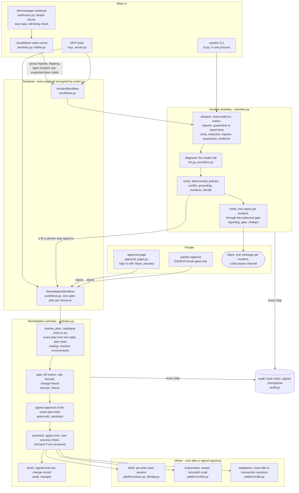

# Architecture

WARDEN diagnoses a production incident and proposes at most one fix. A model writes the diagnosis; plain
code decides what may happen next; a person approves any change; and WARDEN itself applies, checks and,
when needed, undoes it. This page describes how the code does that. Every module named here is in
`src/warden/`; if this page and the code disagree, the code is right and this page is a bug.

Related reading: [`ai-boundary.md`](ai-boundary.md) (why the model never decides),
[`PRODUCTION-ARCHITECTURE.md`](PRODUCTION-ARCHITECTURE.md) (how it runs in AWS),
[`SYSTEM-COMPONENTS.md`](SYSTEM-COMPONENTS.md) (every outside component and its cost),
[`FAILURE-MODES.md`](FAILURE-MODES.md) (what can go wrong, and what holds it).

## The whole system on one page



Four rules carry the design:

- **Evidence first, and only typed facts reach the model.** Evidence is read and redacted before the model
  is involved, so the model cannot choose what is looked at. Untrusted text (log lines, events, SQL) reaches
  it only as facts of fixed shapes.
- **The model proposes; rules decide.** The verifier is plain Python over typed data. It never treats the
  model's confidence as a reason to act, only as a reason to stop.
- **Nothing changes without a person.** A fix runs in its own workflow and applies only a plan whose exact
  hash a person signed.
- **Everything is on the record.** Every step writes a row to a hash-chained, signed audit log.

## One incident, end to end

`IncidentWorkflow` (in `workflows.py`) runs one alert. Its workflow id is `inc-<alert id>`, so the same
alert twice is one incident; a repeat while it is open is counted, not started again.

1. **Wait for the logs.** A durable timer waits until the alert's last minutes have reached the log store.
2. **prepare.** Reads the evidence (logs, metrics, deploys, configuration and state reads), redacts it,
   runs the optional injection tripwire, numbers every item with an evidence id, and reduces untrusted
   text to typed facts (`quarantine.py`). The redaction map stays inside this step and never leaves it.
3. **reread** (at most once). If a source answered with nothing right after the alert, it is read again
   when the alert is old enough for that source.
4. **diagnose.** The model call: a hypothesis with a confidence, citations that quote evidence ids, the
   causes it ruled out, and one action from a closed set (`models.ActionKind`). One attempt per call;
   the client enforces a per-incident budget of calls and US dollars (`llm.py`).
5. **investigate** (optional, at most two rounds). The model may ask to read up to three related
   resources. A request is read only if the name is one WARDEN already holds from trusted evidence and
   belongs to the incident's environment (`investigation.py`).
6. **verify.** The deterministic policies (below). One repair round may ask the model again with the
   checks' own words, but only for checks a better answer can pass; safety policies are never fed back.
7. **second opinion.** Before any fix reaches a person, the model is asked once more on the same evidence.
   If the two answers name a different action or target, the fix is escalated. This can only take an
   approval away.
8. **notify and plan.** One message per incident. If the verifier passed a fix for a person, `plan_fix`
   opens a `RemediationWorkflow` for it, and the message carries the request for approval.

With no model, a broken provider or a spent budget, WARDEN still reports: it escalates on the rules alone
and says why.

## From approval to a change

`RemediationWorkflow` carries one catalogue entry from plan to verified result:

```
resolve_plan (live read, catalogue check) -> gate (kill switch, bounds, freeze)
  -> signed approvals until the plan expires -> re-check live state (changed = plan again)
  -> apply ONCE -> its own success check on a timer -> roll back if it did not recover
  -> a signed end row in the audit
```

- **The catalogue is the only set of writes** (`catalog.py`). An entry either restores a known-good state
  WARDEN itself observed (a previous version, task definition or rollout) or makes a small numeric change
  clamped against live values. A parameter must be a value WARDEN read from live state or a bounded number,
  so a target taken from a log line is refused.
- **Tiers.** T1: one small, reversible change to one resource. T2: service-level, reversible. T3:
  irreversible, IAM, network or Terraform; it also needs a cooling-off time and a device-bound passkey.
- **Approvals bind to the plan hash.** The approver signs the workflow id, the plan hash, the tier, a
  single-use nonce and an expiry. A signature for one plan cannot approve another. The approver list
  (`approvals.py`) says who may approve which tiers in which environments, and how many different
  approvers each tier needs.
- **Drift means a new plan.** If the target or WARDEN's own code changed after the plan was made, the plan
  is made again from what WARDEN reads now and put to the approvers again, at most twice.
- **Success is never an input.** The workflow's own check decides recovery: three healthy readings in a
  row, then re-checks 15 and 60 minutes later. Nothing outside the workflow can mark a fix successful.
- **Other alarms after the fix** end the run as "side effects", not as "fixed".

## Trust zones

Each activity runs on the task queue of the zone that holds its credentials (`workflows.ZONES`):

| Zone | Activities | Holds |
|---|---|---|
| core (`warden` queue) | the workflows, the audit's own steps, verify, the gate | the audit, the approver list; no cloud credential for the watched systems |
| read (`warden-read`) | prepare, reread, investigate, plan and precheck, success checks | the watched environments' reader roles |
| llm (`warden-llm`) | diagnose, discussion answers | the model API key; sees only redacted, typed facts |
| notify (`warden-notify`) | notify, announce, finish | Slack, paging and change-record secrets |
| act (`warden-act`) | apply, rollback | no standing role: a per-plan actor session only |

In the cloud each zone is its own service with its own task role and its own Temporal API key
(`terraform/modules/warden-runtime`). The AWS actor session (`identity.py`) lasts at most 900 seconds,
carries the incident as its SourceIdentity and the approvers and plan as session tags, and has a session
policy that allows only the plan's actions on the plan's exact resources. A separate check
(`actor_use.py`) reads CloudTrail for every use of an actor role and pages a person if the audit shows no
approval for it.

## The safety layers

| Layer | Module | What it does |
|---|---|---|
| Redaction | `redaction.py` | Masks credentials, personal data and identifiers before anything reaches a model. Regex based: strong against accidental leaks, not a guarantee against a determined adversary. |
| Quarantine | `quarantine.py`, `evidence.py` | Untrusted text becomes typed facts (a level, an error code, a status, a closed-vocabulary phrase, `key=value`, sizes and durations). None can carry a sentence. |
| Injection tripwire | `tripwire.py` | Optional. Meta's Llama Prompt Guard 2 scores untrusted lines locally; a flagged line sends the incident to a person (policy P16). It is a tripwire, never a gate that clears text. |
| Policies | `verifier.py`, `grounding.py`, `activities.py`, `catalog.py` | Numbered policies P0 to P33, all plain code. Most run when the diagnosis is verified; a few run when a plan is made (P18 the target's environment matches the incident's, P19 a change freeze, P21 a rollout already under way). P25-P28 run in observe mode: recorded and shown, never obeyed, until measured. |
| Outbound gate | `gate.py` | The last check on every way out (chat, terminal, MCP, webhooks). G2 marks claims WARDEN cannot verify; G3 removes links, images and markup an attacker could plant; G4 withholds write commands from model text; G5 blocks a message that still holds a secret. |
| Bounds and kill switch | `bounds.py` | Per-service and per-action-class rate limits; a breaker that trips the kill switch after repeated failed success checks. The switch is reset only by a signed approval of that trip. |
| Change freeze | `freeze.py` | No fix is applied inside a declared freeze window; a window that cannot be read refuses the change. |
| Audit | `audit.py` | A hash chain with signed checkpoints. In the cloud the signer is an AWS KMS Ed25519 key and checkpoints are anchored in S3 Object Lock. `warden audit verify` checks it offline. |
| Payload encryption | `codec.py` | AES-256-GCM over every Temporal payload, bound to its namespace and workflow, so the Temporal server holds only ciphertext. |

The verifier's verdicts, by precedence: `rejected` (nothing runs) > `escalated` (a person decides) >
`auto_safe` (only `no_action` or `escalate_to_human`, which change nothing) > `approved_for_human` (a fix a
person may approve). Every policy that applies is recorded, not just the first. The main policies and the
failure each one prevents are listed in [`ai-boundary.md`](ai-boundary.md).

## People and records

- **The approval page** (`approval_page.py`, served by a Lambda behind API Gateway). A Slack button opens a
  link that is valid for 15 minutes, for one approver and one workflow, and used once. The person signs in
  with Slack (`slack_login.py`), which says which member they are, then proves it with their passkey;
  only then is the plan shown. For T2 and T3 they type the target, and the passkey signs a challenge that
  is the plan (`passkeys.py`). The workflow re-verifies the assertion itself.
- **Break-glass.** `warden approve` signs the plan hash with an Ed25519 key held by the approver.
- **Records pages** (`records.py`): every incident, its plan, who approved or denied it and why, and how it
  ended, read from the signed audit. Nothing on them is written back. The list pages (10, 25, 50 or 100 a page)
  and filters by environment, status, service, days and title text; a reader whose approver entries are limited
  to some environments sees only those. Every page has a light, dark or system theme and WARDEN's logo.
- **Discussion** (`discuss.py`): anyone in a second Slack channel can ask WARDEN about an incident; WARDEN
  answers from the incident's own evidence. Only an enrolled approver may ask for a new plan, and that plan
  still needs a passkey approval.

## Evidence backends

`tools.resolve_backend` picks the evidence source from `WARDEN_BACKEND`. Every backend is read-only by
construction, and its identity is scoped to reads.

| Backend | `WARDEN_BACKEND` | Reads |
|---|---|---|
| Fixtures | `fixture` (default) | recorded incidents shipped as package data, for the demo and CI |
| AWS | `aws` | CloudWatch Logs and metrics, ECS service state and deploys (`aws_backend.py`); for a full stack, the alarm's own resource across many AWS services, its configuration and recent CloudTrail changes (`aws_stack.py`, `aws_describe.py`, `resources.py`) |
| Kubernetes | `k8s` | pod status, events, recent log lines and the previous crashed run's last lines, Deployments, ReplicaSets, rollout history and the HorizontalPodAutoscaler (`k8s_backend.py`) |
| Databases | `postgres`, `mysql`, `redis`, `mongo`, `mssql` | each engine's own session views: connections, idle-in-transaction sessions, long queries, lock waits, replica lag (`database.py`) |

Datadog (`datadog.py`), Grafana Loki, Tempo and Prometheus (`grafana.py`) and AWS X-Ray (`xray.py`) are
read beside the main backend when their read keys are set. WARDEN's own cloud runtime reads Datadog only;
Grafana's keys have no slot there and are read only from the process environment, where an adopter sets them.

Every read runs under a deadline (`WARDEN_TOOL_TIMEOUT`). A failed or timed-out read becomes an entry in
`context.tool_errors`, which policy P8 reads, so a partial picture is visible to the verifier instead of
looking complete. A timed-out thread is abandoned, not killed; Python cannot stop one.

Beside the backend, `tools.evidence_tools` adds readers that are switched on (X-Ray, Grafana, Datadog, the deploy's
commits, and code review's findings on the deploy's pull request - `findings.py`, register G10-59). The findings are
text a pull request's author or a bot wrote, so they enter as typed `FINDING` lines only (evidence kind R): the model is
shown them between data markers and may cite them, grounding never lets one support an action on its own, and a
finding whose text reads as an instruction is held back and counted.

### `KubernetesBackend` — what it is honest about

**Kubernetes access** is a ClusterRole holding six reads (list pods, get pod logs, list events, get
deployments, list replicasets, list horizontalpodautoscalers), granted by a RoleBinding in each namespace
WARDEN may diagnose, never a ClusterRoleBinding (`k8s/rbac.yaml`). CI asks a real API server both ways:
those reads must be allowed, and writes, unbound namespaces, cluster-scoped reads and secrets must be denied.

## Model access

`llm.LLMClient` is the only path to a model. It returns a validated Pydantic object or fails; there is no
path that accepts unvalidated model text. It counts every call against a per-incident ceiling of calls and
US dollars and stops when either is reached; a daily cap across incidents is read from the audit.

`providers.py` holds the providers: `anthropic` (the default), `bedrock`, `gemini`, OpenAI-compatible
endpoints, and the local `claude` CLI. The default model per provider and the list of qualified models are
data in `src/warden/data/providers.yaml`. A model must pass WARDEN's replay qualification before it may
diagnose; an unqualified model is refused, and every incident is then escalated on the rules alone.

## Tracing

`observability.py` wires OpenTelemetry: a span for the run, each read, the model call and the verdict,
with confidence, action, verdict, policies and token cost as attributes. No exporter by default;
`OTEL_EXPORTER_OTLP_ENDPOINT` sends spans to a collector, `WARDEN_TRACE_CONSOLE=1` prints them, and
`WARDEN_TRACE=0` turns tracing off. Telemetry never takes the system down: a missing exporter falls back
to the console.

## Running without Temporal or a model

`graph.py::run()` runs the same incident steps (`ingest -> gather -> redact -> diagnose -> verify`) in one
process, for the CLI, the benchmark harness and the tests. `WARDEN_MOCK=1` replaces the model with
deterministic answers built from typed state, so the demo and CI need no key and no network.

## Testing

- `tests/`: unit and property tests. Every policy has a test that proves it can fire, and the tests that
  guard a safety rule are checked by breaking the rule and watching the test fail.
- `evals/`: behavioural checks in mock mode: routing per incident, that nothing is applied without
  approval, redaction, cost recording and budget enforcement. They catch drift in the deterministic parts;
  they do not measure live model quality.
- CI also runs a real k3d cluster with a pod that really runs out of memory, and the five database engines
  as service containers.
